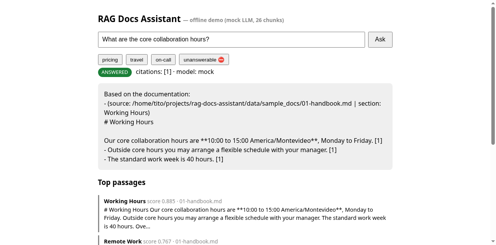
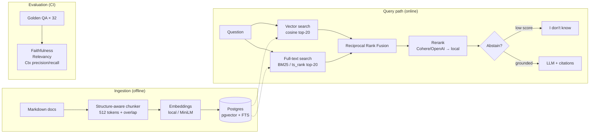

# RAG Docs Assistant

A production-grade **Retrieval-Augmented Generation (RAG)** assistant over company
documentation: hybrid search (vector + full-text, fused with RRF), reranking, cited
answer generation with abstention, and RAGAS-style offline evaluation.

> Built with Claude Code / Cursor — AI-pair-programmed, human-reviewed.
>
> ✅ **Live-verified** against a real LLM API (opencode Zen, free `beam-free` model, 2026-11-05) — see `docs/LIVE_VERIFIED.md`.

## Demo



*Cited answer with the `[1]` source marker plus ranked passages — `./demo.sh`, then open `http://127.0.0.1:8000/ui`.*

## Problem

Support teams and employees waste hours digging through handbooks, FAQs, and policy
docs. Keyword search misses paraphrases; pure vector search misses exact terms
(prices, limits, SLAs); LLM-only answers hallucinate. This project combines both
retrieval signals, reranks, and forces the generator to cite sources — or abstain
when the docs don't contain the answer.

## Architecture



See [ARCHITECTURE.md](ARCHITECTURE.md) for design decisions and trade-offs.

## Stack

| Layer | Choice |
|---|---|
| API | FastAPI + SSE streaming (`sse-starlette`) |
| Vector + FTS | Postgres 16 + pgvector (HNSW) + `tsvector` |
| Embeddings | `sentence-transformers/all-MiniLM-L6-v2` locally; hash-embedding fallback for offline/tests |
| Rerank | Cohere Rerank / OpenAI pointwise, fallback to local scorer |
| Generation | OpenAI chat completions, fallback to deterministic mock |
| Evals | RAGAS-style offline metrics over a 32-pair golden set |
| Tests | pytest (offline, mocked) |
| Deploy | Docker Compose (api + postgres) |

No API keys are required for the core flow: tests, evals, and the demo run
fully offline.

## Quickstart

```bash
git clone <this-repo> && cd rag-docs-assistant
cp .env.example .env

# Option A — Docker (production-like, with Postgres)
docker compose up --build
# API at http://localhost:8000  |  docs at /docs

# Option B — local, fully offline (in-memory backend + mock LLM)
python -m venv .venv && source .venv/bin/activate
pip install -r requirements.txt
uvicorn src.api:app --reload --port 8000
```

Ingest your own docs:

```bash
curl -X POST localhost:8000/ingest \
  -H 'Content-Type: application/json' \
  -d '{"source": "handbook.md", "markdown": "## Time Off\n\nEmployees get 20 vacation days..."}'
```

Ask a question:

```bash
curl -X POST localhost:8000/query \
  -H 'Content-Type: application/json' \
  -d '{"question": "How many vacation days do I get?", "top_k": 5}'
```

Streaming (SSE):

```bash
curl -N -X POST localhost:8000/query/stream \
  -H 'Content-Type: application/json' \
  -d '{"question": "What is the hotel cap?", "top_k": 5}'
```

## Demo

Offline mode auto-loads `data/sample_docs/` (handbook, FAQ, expense policy,
on-call guide) on startup, so the first query works immediately:

```bash
uvicorn src.api:app --port 8000 &
curl -X POST localhost:8000/query \
  -H 'Content-Type: application/json' \
  -d '{"question": "What does the Team plan cost and what is its support SLA?"}'
```

```json
{
  "answer": "Based on the documentation:\n- **Team**: USD 12 per user per month, unlimited retention, SSO included. [2]\n- Team: email support, 8-hour response target on business days. [2]",
  "citations": [2],
  "abstained": false,
  "model": "mock"
}
```

## Evals

```bash
python eval/run_evals.py --min-mean 0.35
```

Runs the 32-pair golden set through retrieve → rerank → generate and reports
faithfulness, answer relevancy, context precision, and context recall.
Exits non-zero if the mean score drops below the gate — wire it into CI.

## Tests

```bash
pytest -q
```

38 tests, all offline (hash embeddings, in-memory retriever, mock LLM).

## Project layout

```
├── src/
│   ├── config.py      # Pydantic Settings (env-driven)
│   ├── ingest.py      # Structure-aware Markdown chunking
│   ├── embeddings.py  # Local-hash + sentence-transformers providers
│   ├── retrieval.py   # BM25 + vector + RRF (in-memory & Postgres)
│   ├── rerank.py      # Cohere/OpenAI/local rerank chain
│   ├── generate.py    # Cited generation + abstention, streaming
│   ├── evals.py       # RAGAS-style offline metrics
│   └── api.py         # FastAPI: /ingest /query /query/stream /health
├── tests/             # pytest, offline
├── eval/              # golden_qa.json + run_evals.py
├── data/sample_docs/  # 4 synthetic company docs
├── sql/init.sql       # pgvector schema
└── docker-compose.yml
```

## Configuration

All tunables live in `.env` (see `.env.example`): chunk size/overlap, top-k at
each stage, RRF smoothing `k`, BM25 `k1`/`b`, rerank/LLM providers and keys,
abstention threshold.

## License

MIT.
